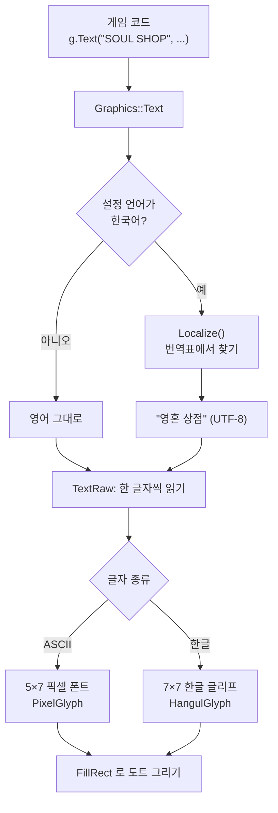

# 언어 설정(한글 패치) 구조 정리

> v0.5.0 에서 설정에 언어(English / 한국어)를 넣으면서 정리한 기록이다.
> 다국어를 처음 붙여 보는 사람도 "글자가 어떻게 한글로 바뀌어서 화면에 나오는지" 따라올 수 있게 적었다.

한 줄로 요약하면 이렇다.

**게임 코드는 영어 문장을 그대로 쓰고, 화면에 글자를 그리는 그 순간에 번역표를 보고 한국어로 바꿔 그린다.**

## 목차

1. [왜 이 방식을 골랐나](#1-왜-이-방식을-골랐나)
2. [전체 흐름](#2-전체-흐름)
3. [파일별 역할](#3-파일별-역할)
4. [언어 설정 값](#4-언어-설정-값)
5. [번역: 영어 문장을 한국어로](#5-번역-영어-문장을-한국어로)
6. [한글 글자 그리기](#6-한글-글자-그리기)
7. [한글 글리프 굽기 도구](#7-한글-글리프-굽기-도구)
8. [줄바꿈과 한 글자씩 나오는 연출](#8-줄바꿈과-한-글자씩-나오는-연출)
9. [따라 하기: 새 문장 번역 넣기](#9-따라-하기-새-문장-번역-넣기)
10. [번역 누락 찾기](#10-번역-누락-찾기)
11. [하면서 걸렸던 함정](#11-하면서-걸렸던-함정)
12. [배운 점](#12-배운-점)

---

## 1. 왜 이 방식을 골랐나

한글 패치를 하려면 두 가지가 필요했다.

1. **한글 글자 모양(폰트)**: 원래 폰트는 5×7 픽셀짜리 ASCII 대문자/숫자만 있었다. 한글이 하나도 없었다.
2. **문장 번역**: 화면 문장 330개 정도가 코드 곳곳(`g.Text("SOUL SHOP", ...)` 같은 식)에 영어로 박혀 있었다.

번역을 붙이는 방법으로 두 가지를 놓고 고민했다.

| 방법 | 어떻게 | 장점 | 단점 |
|---|---|---|---|
| A. 키로 바꾸기 | 코드의 `"SOUL SHOP"` 을 전부 `Tr(Str::SoulShop)` 같은 키로 바꾸고, 언어별 표를 둔다 | 정석적이다. 같은 영어라도 키를 나눌 수 있다 | 화면 코드 127곳을 전부 고쳐야 한다 |
| **B. 그릴 때 번역 (선택)** | 코드는 영어 그대로 두고, 글자를 그리는 `Graphics::Text` 안에서 표를 찾아 바꾼다 | 화면 코드를 거의 안 고친다. 영어 모드는 원래와 완전히 똑같다 | 숫자가 섞인 문장, 줄바꿈 같은 건 따로 챙겨야 한다 |

이 게임은 모든 글자가 `Graphics::Text` 한 곳을 지나간다. 그래서 거기 한 군데만 손보면 되는 **B** 를 골랐다.
숫자가 섞인 문장은 "숫자 틀"(5장)로, 줄바꿈과 타자기 연출은 따로(8장) 챙겼다.

---

## 2. 전체 흐름



플레이어가 설정에서 언어를 바꾸면 `Prefs().language` 값 하나만 바뀐다.
다음 프레임부터 모든 `Text` 호출이 그 값을 보고 번역하기 때문에, 화면을 다시 만들 필요 없이 바로 바뀐다.

---

## 3. 파일별 역할

| 파일 | 하는 일 |
|---|---|
| [Settings.h](../Source/Public/core/Settings.h) | `Language { English, Korean }` 와 설정 값 `language` |
| [Menu.cpp](../Source/Private/ui/Menu.cpp) | 설정 화면의 "LANGUAGE" 줄 (← → 로 바꾸기) |
| [Locale.h](../Source/Public/core/Locale.h) / [Locale.cpp](../Source/Private/core/Locale.cpp) | 번역 엔진: `Localize()`, `WrapLocalized()`, UTF-8 글자 세기 |
| [LocaleKo.cpp](../Source/Private/core/LocaleKo.cpp) | 영어 → 한국어 번역표 (약 330문장) |
| [Graphics.cpp](../Source/Private/platform/Graphics.cpp) | `Text` 에서 번역 호출, `TextRaw` 에서 한글/영어 글자 그리기 |
| [PixelFont.h](../Source/Private/platform/PixelFont.h) / [PixelFont.cpp](../Source/Private/platform/PixelFont.cpp) | 영어 5×7 폰트, UTF-8 읽기(`NextCodepoint`), 글자 폭(`GlyphAdvance`) |
| [HangulGlyphs.cpp](../Source/Private/platform/HangulGlyphs.cpp) | **자동 생성.** 게임에 쓰는 한글 392자의 7×7 비트맵 |
| [tools/fontgen/gen_hangul.py](../tools/fontgen/gen_hangul.py) | 위 파일을 만드는 도구 |
| [res/fonts/Galmuri-LICENSE.txt](../res/fonts/Galmuri-LICENSE.txt) | 한글 원본 폰트(갈무리) 라이선스 |

---

## 4. 언어 설정 값

설정은 `Prefs()` 라는 전역 접근자로 읽는다. 여기에 값 하나를 추가했다.

```cpp
enum class Language { English, Korean };

struct Settings {
  int volume = 7;
  int shake = 2;
  JumpControl jump = JumpControl::Variable;
  Language language = Language::English;  // 추가
};
```

설정 화면에는 "LANGUAGE" 줄을 넣었다. 화면 흔들림(OFF / LOW / FULL)처럼 값을 나란히 놓고 고른 칸만 채우는 방식을 그대로 썼다.
언어 이름 `ENGLISH` / `한국어` 는 **번역하지 않는다.** 한국어를 모르는 사람도 "한국어"를 찾을 수 있어야 하고, 반대도 마찬가지라서 각 언어로 적었다.

> 지금은 설정이 파일에 저장되지 않는다. 게임을 다시 켜면 English 로 돌아온다. (효과음, 화면 흔들림도 마찬가지)

---

## 5. 번역: 영어 문장을 한국어로

`Localize(s)` 가 하는 일을 순서대로 적으면 이렇다.

### 5-1. 문장 통째로 찾기

번역표는 그냥 영어와 한국어 짝의 목록이다.

```cpp
const LocaleEntry kKorean[] = {
    {"SOUL SHOP", "영혼 상점"},
    {"NEW GAME", "새 게임"},
    ...
};
```

처음 쓸 때 이걸 `unordered_map` 으로 한 번 만들어 두고, 문장을 키로 찾는다.

### 5-2. 앞뒤 공백은 남겨 두기

코드에 `g.TextWidth("NEED ", 2)` 처럼 **뒤에 공백을 붙여 폭을 재는 곳**이 있었다. 공백까지 키로 찾으면 표에 없다고 나온다.
그래서 앞뒤 공백을 떼고 찾은 다음, 번역 결과에 다시 붙인다. (`"NEED "` → `"부족 "`)

### 5-3. 숫자가 든 문장은 "틀"로 찾기

`"STAGE 1"`, `"STAGE 2"`, `"SCORE 004260"` 처럼 숫자가 바뀌는 문장은 표에 하나하나 넣을 수 없다.
그래서 통째로 못 찾으면 **숫자를 `#` 로 바꾼 틀**로 한 번 더 찾는다.

```
"STAGE 2"          → 틀 "STAGE #"        (숫자: 2)
표: "STAGE #"      → "스테이지 #"
결과                → "스테이지 2"
```

`1.5` 같은 소수도 숫자 하나로 본다. 숫자가 여러 개면 나온 순서대로 다시 넣는다.

```
"WAVE 2/3"  → 틀 "WAVE #/#"  → "웨이브 #/#"  → "웨이브 2/3"
```

### 5-4. 어순이 바뀌는 문장은 `{1}` `{2}`

영어와 한국어는 어순이 다르다. `"PICK 1 OF 3 CARDS"` 를 그대로 순서대로 넣으면 "카드 1장 중 3장"이 돼 버린다.
이럴 때는 한국어 쪽에 **몇 번째 숫자**인지 적는다.

```cpp
{"PICK # OF # CARDS", "카드 {2}장 중 {1}장 고르기"},
// "PICK 1 OF 3 CARDS" → "카드 3장 중 1장 고르기"
```

### 5-5. 결과 기억해 두기 (캐시)

같은 문장을 매 프레임(1초에 60번) 그리니까 매번 표를 뒤지면 아깝다. 한 번 번역한 결과는 `cache` 에 기억해 둔다.
점수처럼 계속 바뀌는 글자가 쌓이면 끝없이 커지니까, 4096개를 넘으면 한 번 비운다.

### 5-6. 표에 없으면?

영어를 그대로 돌려준다. 그래서 번역을 빼먹어도 게임이 깨지지 않고 그 문장만 영어로 나온다.
`ENGLISH` 나 키 이름(`ESC`, `ENTER`, `TAB`)처럼 일부러 영어로 두는 것도 이 덕분에 표에 안 넣으면 끝이다.

---

## 6. 한글 글자 그리기

### 6-1. UTF-8 이 뭔가

C++ 의 `std::string` 은 바이트 배열이다. 영어 `A` 는 1바이트지만, 한글 `가` 는 UTF-8 로 **3바이트**다.

```
"A"   → 41
"가"  → EA B0 80
```

원래 코드는 `for (char ch : s)` 로 1바이트씩 글자를 그렸다. 한글을 넣으면 `가` 한 글자를 깨진 글자 3개로 그리게 된다.
그래서 `NextCodepoint(s, i)` 를 만들어서 **바이트가 아니라 글자 단위**로 읽게 했다. 첫 바이트를 보고 몇 바이트짜리 글자인지 판단한다.

| 첫 바이트 | 글자 길이 | 예 |
|---|---|---|
| `0xxxxxxx` (0x00~0x7F) | 1바이트 | 영어, 숫자, 기호 |
| `110xxxxx` (0xC0~) | 2바이트 | 유럽 글자 |
| `1110xxxx` (0xE0~) | 3바이트 | **한글** |
| `11110xxx` (0xF0~) | 4바이트 | 이모지 |

### 6-2. 한글 폰트: 갈무리7

배포해도 되는 한글 픽셀 폰트로 [갈무리(Galmuri)](https://github.com/quiple/galmuri)를 썼다. SIL Open Font License 1.1 이라서 게임에 넣어 무료로 배포해도 된다. (라이선스 파일을 같이 둬야 한다)

갈무리에는 크기별로 7, 9, 11, 14 가 있는데 **갈무리7 을 고른 이유**는 한글이 정확히 7×7 픽셀이기 때문이다.
원래 영어 폰트가 5×7 이라서 **높이가 같다.** 그래서 `scale` (배율) 개념을 그대로 쓸 수 있다. `scale = 2` 면 영어든 한글이든 14픽셀 높이로 나온다.

| | 글자 그림 | 차지하는 폭 (배율 1) |
|---|---|---|
| 영어 | 5×7 | 6 (5 + 간격 1) |
| 한글 | 7×7 | 8 (7 + 간격 1) |

한글이 영어보다 폭이 넓어서, 폭을 재는 `TextWidth` 도 글자마다 `GlyphAdvance(cp)` 로 따로 더하게 바꿨다.

### 6-3. 한 글자를 7바이트로 저장

한글 한 글자는 7줄이고, 한 줄은 8칸이라 **1바이트**에 딱 들어간다. 맨 왼쪽 칸이 가장 높은 비트(`0x80`)다.
예를 들어 `팬` 은 이렇게 저장돼 있다.

```
#####.#.   0xfa
.##.#.#.   0x6a
.##.###.   0x6e
#####.#.   0xfa
....#.#.   0x0a
.#......   0x40
.######.   0x7e
```

```cpp
{0xd32c, {0xfa, 0x6a, 0x6e, 0xfa, 0x0a, 0x40, 0x7e}},  // 팬
```

그릴 때는 줄마다 켜진 칸이 이어지는 구간을 찾아 `FillRect` 한 번으로 그린다. 영어 폰트를 그리던 방식과 똑같다.

### 6-4. 왜 한글 11,172자를 다 안 넣었나

한글 음절은 11,172자다. 다 넣으면 코드가 커지고, 실제로 게임에 쓰는 글자는 **392자**뿐이다.
그래서 번역표에 쓰인 글자만 골라서 넣는다. 글자를 찾을 때는 코드 순으로 정렬해 두고 이진 탐색(`std::lower_bound`)을 쓴다.

---

## 7. 한글 글리프 굽기 도구

`HangulGlyphs.cpp` 는 사람이 직접 쓰지 않는다. [tools/fontgen/gen_hangul.py](../tools/fontgen/gen_hangul.py) 가 만든다.

```bash
python tools/fontgen/gen_hangul.py <Galmuri7.bdf 경로>
```

이 도구가 하는 일은 세 가지다.

1. `Source/` 아래 모든 `.cpp`, `.h` 의 **문자열 리터럴**(`"..."` 안)에서 한글 음절을 모은다. 주석의 한글은 안 모은다.
2. 갈무리7 의 BDF 파일(글자마다 비트맵이 텍스트로 적힌 폰트 형식)에서 그 글자들의 비트맵을 꺼낸다.
3. 7바이트 배열로 바꿔서 `HangulGlyphs.cpp` 를 쓴다. 폰트에 없는 글자가 있으면 `missing in font:` 로 알려 준다.

> 갈무리 BDF 파일은 저장소에 넣지 않았다. [갈무리 릴리스](https://github.com/quiple/galmuri/releases)에서 zip 을 받아 `Galmuri7.bdf` 경로를 넘기면 된다.

---

## 8. 줄바꿈과 한 글자씩 나오는 연출

"그릴 때 번역" 방식에서 따로 챙겨야 했던 곳이 두 군데 있다.

### 8-1. 카드 설명 줄바꿈

카드 설명은 길어서 여러 줄로 나눠 그린다. 원래는 **영어 문장을 먼저 줄로 나눈 다음** 줄마다 `Text` 를 불렀다.
그러면 `"SHOTS EXPLODE ON HIT,"` 처럼 잘린 영어 조각이 들어와서 번역표에 없다고 나온다.

그래서 순서를 바꿨다. **번역을 먼저 하고, 번역된 문장을 줄로 나눈다.** 이게 `WrapLocalized(text, maxChars)` 다.
줄 길이도 바이트 수가 아니라 실제 폭(영어 6, 한글 8)으로 잰다. 상점, 카드 고르기, 상태 창에 따로 있던 줄바꿈 함수 3개를 이걸로 합쳤다.

### 8-2. 컷신 타자기 연출

컷신 대사는 한 글자씩 나온다. 원래는 `full.substr(0, shown)` 처럼 **바이트**로 잘랐다.
한글은 3바이트라서, 이러면 글자 중간이 잘려 깨진 글자가 잠깐씩 보인다.

그래서 `CharCount()` (글자 수)와 `FirstChars(s, n)` (앞에서 n 글자)를 만들어서 글자 단위로 자른다.
대사는 번역을 먼저 하고 나서 자른다. 줄바꿈 기호 `\n` 은 번역표에도 그대로 넣었다.

---

## 9. 따라 하기: 새 문장 번역 넣기

새 화면이나 카드를 만들어서 영어 문장이 늘었을 때 하는 순서다.

1. 코드에는 지금처럼 영어로 쓴다.
   ```cpp
   g.Text("TREASURE ROOM", x, y, 3, color);
   ```
2. [LocaleKo.cpp](../Source/Private/core/LocaleKo.cpp) 에 한 줄 넣는다. 숫자가 바뀌는 문장이면 숫자 자리를 `#` 로 적는다.
   ```cpp
   {"TREASURE ROOM", "보물 방"},
   {"FLOOR #", "#층"},
   ```
3. 새 한글 글자가 생겼을 수 있으니 글리프를 다시 굽는다.
   ```bash
   python tools/fontgen/gen_hangul.py <Galmuri7.bdf 경로>
   ```
4. 빌드하고 `--lang=ko` 로 확인한다.

> 3번을 빼먹으면 새 글자가 **빈칸**으로 나온다. 글자가 안 보이면 제일 먼저 의심할 곳이다.

### 새 언어(예: 일본어)를 추가하려면

지금 구조로는 이런 순서가 된다.

1. `Language` 에 `Japanese` 추가, 설정 화면 값 개수 늘리기
2. `LocaleJa.cpp` 번역표 추가, `Localize()` 에서 언어에 맞는 표 고르기
3. 일본어 글리프 굽기 (가나 + 쓰는 한자). 갈무리에 일본어 글자도 들어 있다.

---

## 10. 번역 누락 찾기

화면을 하나하나 눈으로 보면 빠진 문장을 놓친다. 그래서 **로그로 찾게** 만들었다.

번역표에도 없고 숫자 틀에도 없는데 영어 대문자가 두 글자 이상 이어지는 문장이면, `log=1` 일 때 이렇게 찍는다.

```
[locale] no korean: "TREASURE ROOM"
```

자동 플레이 봇과 같이 돌리면 스테이지와 상점을 지나가면서 나오는 문장을 알아서 훑어 준다.

```bash
AdventureOfGengar.exe --lang=ko --log --bot --god --speed=8
```

웹이면 주소 뒤에 `?lang=ko&log=1&bot=1&god=1&speed=8` 를 붙인다. 처음 돌렸을 때 버전 표시(`v0.5.0 BETA`)와 경험치 숫자(`13/21 XP`)만 나왔고, 둘 다 영어로 두는 게 맞아서 "그대로" 번역을 표에 넣어 조용히 시켰다.

---

## 11. 하면서 걸렸던 함정

| 함정 | 증상 | 해결 |
|---|---|---|
| `text.size()` 로 폭 계산 | 메뉴의 `> <` 화살표가 한글 메뉴에서 너무 멀리 떨어짐 (바이트가 3배라서) | `g.TextWidth(text, 3)` 로 실제 폭을 쓴다 |
| 줄로 나눈 뒤 번역 | 카드 설명이 영어 그대로 나옴 | 번역 먼저, 줄바꿈 나중 (`WrapLocalized`) |
| 바이트로 자르는 타자기 | 대사가 나오는 중에 깨진 글자가 보임 | 글자 단위로 자르기 (`FirstChars`) |
| 대사 길이를 `strlen` 으로 계산 | 한글 대사가 다 나왔는데도 타자기 소리가 계속 남 | `CharCount(Localize(text))` |
| `\n` 들어간 문장 | 번역할 문장을 모을 때 `\n` 이 든 대사를 빠뜨려서 컷신 첫 두 문장이 영어로 나옴 | 컷신을 직접 보다가 발견해서 추가. 그 뒤로 누락 로그를 만들었다 |
| 한국어가 영어보다 김 | 상점의 "희귀 이상 1장, 뽑을 때마다 +25" 가 칸을 넘침 | 번역을 줄임 ("희귀+ 1장, 뽑을수록 +25") |
| 영어 이름으로 비교하는 코드 | `label == "UP"` 처럼 영어로 키캡을 판단하는 곳 | 비교는 번역 전 영어로 하니까 그대로 둬도 된다. 번역은 그릴 때만 일어난다 |

---

## 12. 배운 점

- **모든 글자가 한 곳을 지나가게 만들어 둔 덕을 봤다.** `Graphics::Text` 하나만 고쳐서 화면 127곳이 한꺼번에 번역됐다. 처음부터 글자 그리기를 한 함수로 모아 둔 게 다국어에서 크게 도움이 됐다.
- **문자열 길이 = 글자 수 = 화면 폭이 아니다.** 영어만 쓸 때는 셋이 같아서 몰랐는데, 한글을 넣자 바이트 수(3), 글자 수(1), 화면 폭(8)이 다 달라졌다. 어디서 무엇을 재는지 구분해야 한다.
- **번역은 표에 없을 때 깨지지 말고 영어로 나오게 하자.** 덕분에 빠진 문장이 있어도 게임은 멀쩡하고, 로그로 천천히 채울 수 있었다.
- **눈 대신 로그로 확인하자.** 봇 + 누락 로그 조합이 화면을 일일이 넘겨 보는 것보다 빠르고 빠짐이 없었다.
