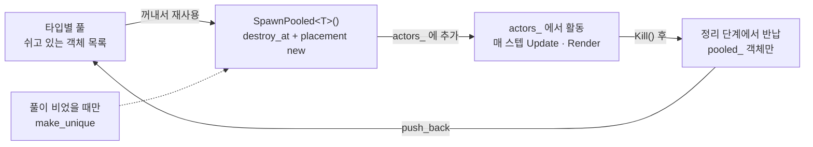
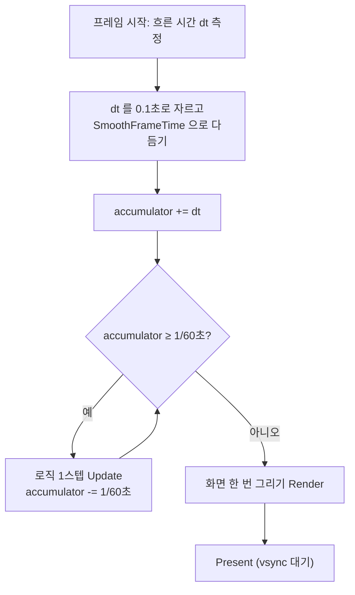

# 최적화 기술 정리

> 기준 버전: v0.4.8 · 2026-10-24

이 게임은 크게 네 갈래로 최적화했다: **메모리 할당 줄이기**, **프레임당 연산 줄이기**, **화면 끊김 없애기**, **파일 없이 가볍게 배포하기**.
측정해 보니 그리기 자체는 프레임당 1ms도 안 걸려서, 체감 성능의 핵심은 **프레임 타이밍**이었다.

## 목차

1. [한눈에 보기](#한눈에-보기)
2. [메모리·객체 관리](#메모리객체-관리)
3. [게임 로직·충돌](#게임-로직충돌)
4. [프레임 타이밍·렌더링](#프레임-타이밍렌더링)
5. [리소스·빌드·배포](#리소스빌드배포)
6. [앞으로 해볼 만한 최적화](#앞으로-해볼-만한-최적화)

---

## 한눈에 보기

| 분야 | 기술 | 적용 위치 | 효과 |
| --- | --- | --- | --- |
| 메모리 | 오브젝트 풀링 | `World::SpawnPooled` (섀도우볼, 적 탄, 충격파, 분신 폭발) | 탄이 수백 발 나가도 new/delete 가 거의 없음 |
| 메모리 | 한 번에 당겨 담는 죽은 액터 정리 | `World::Update` | 중간 삭제 없이 O(n) 한 번으로 정리 |
| 메모리 | 미리 공간 잡기 (`reserve`) | 액터 목록 256, 사운드 보이스 24 | 게임 중 벡터 재할당 방지 |
| 메모리 | 고정 크기 배열과 원형 버퍼 | `ShadowBall` 의 맞힌 목록·잔상 위치 | 탄 하나당 힙 할당 0 |
| 로직 | 인덱스 기반 순회 | `World::ForEach` | 순회 중 새 액터가 생겨도 안전 |
| 로직 | 격자 좌표로 타일 충돌 바로 조회 | `Level::Solid`, 탄·캐릭터 충돌 | 타일 수와 상관없이 O(1) |
| 로직 | 효과음 보이스 개수 상한 | `Audio` | 소리 개수가 무한히 늘지 않음 |
| 타이밍 | 60Hz 고정 스텝 + 누적기 | `Game::Frame` | 모니터와 상관없이 같은 게임 속도 |
| 타이밍 | 프레임 간격 다듬기 | `Game::SmoothFrameTime` | 2초당 끊김 15~50번 → 0번 |
| 렌더링 | OpenGL 렌더러 지정 + 배칭 | `Graphics::Init` (Windows) | 고르게 60fps 유지 |
| 렌더링 | 화면에 보이는 타일만 그리기 | `LevelRenderer` | 맵 길이와 상관없이 그리기 비용 일정 |
| 렌더링 | 스프라이트 텍스처 미리 굽기 (+ 흰색 피격판) | `Graphics::CreateSprite` | 매 프레임 픽셀 작업 0, 셰이더 없이 피격 번쩍임 |
| 리소스 | 에셋을 코드에 내장 (스프라이트, 폰트, 효과음 합성) | `SpriteData.cpp`, `PixelFont.cpp`, `Audio.cpp` | 파일 로딩 0, 웹 빌드 단순 |
| 배포 | 정적 링크 | `build_win.ps1`, `GENGAR_DIST` | exe 파일 하나로 실행 |
| 도구 | 성능 측정 옵션 `--perf` | `Game::RecordPerf` | 추측 대신 측정으로 원인 확인 |

---

## 메모리·객체 관리

탄처럼 1초에 수십 번 생겼다 사라지는 객체는 매번 new/delete 하지 않고 **같은 메모리를 돌려 쓰도록** 만들었다.

### 1. 오브젝트 풀링

- **무엇**: 죽은 객체를 지우지 않고 타입별 풀에 돌려놨다가, 다음에 같은 타입을 만들 때 꺼내 쓰는 기법.
- **어디에**: `World::SpawnPooled<T>` 로 만드는 것 전부.
  - 플레이어 섀도우볼 (분열 조각·필살기 비 포함)
  - 적과 보스의 탄 (`EnemyOrb`)
  - 두꺼비·보스의 충격파 (`Shockwave`)
  - 분신 폭발 (`DashBlast`)
- **어떻게**:
  1. 풀은 `unordered_map<type_index, vector<unique_ptr<Actor>>>` 로, 타입마다 쉬고 있는 객체 목록을 따로 둔다.
  2. 풀에 객체가 있으면 꺼내서 `std::destroy_at` 으로 소멸자만 부르고, 같은 주소에 placement new 로 생성자를 다시 부른다. 생성자가 곧 초기화라서 `Reset()` 함수를 따로 만들 필요가 없다.
  3. 죽은 액터를 정리할 때 `pooled_` 표시가 있으면 해제하지 않고 풀로 돌려보낸다.
  4. 스테이지가 끝날 때 `created / reused` 수를 로그로 남겨 재사용률을 확인할 수 있다.

```cpp
T* old = static_cast<T*>(owned.get());
std::destroy_at(old);                                          // 소멸자만
::new (static_cast<void*>(old)) T(std::forward<Args>(args)...); // 같은 메모리에 다시 생성
```



풀이 한 번 차면 점선 경로(새로 만들기)는 거의 안 쓰이고, 실선 네 단계만 도는 구조다.

### 2. 죽은 액터를 한 번에 정리 (압축)

- **무엇**: 벡터 중간에서 `erase` 를 여러 번 하면 뒤 원소를 매번 당겨야 해서 O(n²) 가 된다. 대신 살아 있는 것만 앞으로 당기고 끝에서 한 번 자른다.
- **어디에**: `World::Update` 의 끝부분, 매 로직 스텝.
- **어떻게**: `keep` 인덱스로 살아 있는 액터를 앞으로 옮기고, 죽은 것 중 풀링 대상은 풀로 보내고, 마지막에 `resize(keep)` 한 번으로 나머지를 해제한다. 순서도 유지되어 그리는 순서가 바뀌지 않는다.

### 3. 미리 공간 잡기 (`reserve`)

- **어디에**: 액터 목록 `actors_.reserve(256)`, 사운드 보이스 `voices_.reserve(24)`.
- **효과**: 게임 도중 벡터가 커지면서 전체를 복사하는 재할당이 일어나지 않는다. 사운드는 오디오 콜백(별도 스레드)에서 읽히기 때문에 도중 할당이 없는 게 특히 중요하다.

### 4. 고정 크기 배열과 원형 버퍼

- **무엇**: 탄 하나가 들고 다니는 목록을 `vector` 대신 크기가 정해진 배열로 두어, 탄 안에서 힙 할당이 아예 없게 했다.
- **어디에**: `ShadowBall`
  - `hits_[12]`: 이미 맞힌 대상 (관통 중 같은 적을 두 번 때리지 않게). v0.4.8 부터는 목록이 꽉 차면 더 맞히지 않아 넘침 버그도 막았다.
  - `history_[6]`: 잔상을 그릴 최근 위치. `age_ % 6` 으로 덮어쓰는 원형 버퍼라 오래된 값을 지울 필요가 없다.
- **효과**: 풀링과 합쳐지면, 탄을 아무리 많이 쏴도 풀이 다 찬 뒤에는 메모리 할당이 거의 일어나지 않는다.

---

## 게임 로직·충돌

매 프레임 도는 코드는 **액터 수나 맵 크기에 비례해서 느려지지 않도록** 짰다.

### 1. 인덱스 기반 순회 (`World::ForEach`)

- **무엇**: 액터 목록을 반복자가 아니라 `for (size_t i = 0; i < actors_.size(); ++i)` 처럼 인덱스로 돈다.
- **왜**: 탄이 적을 맞히면 그 자리에서 분열 조각이 생기는 식으로, 순회 도중에 새 액터가 추가된다. 반복자는 벡터가 커지면 무효가 되지만 인덱스는 안전하다. 목록을 복사해 두고 돌 필요도 없다.
- **어디에**: 충돌 판정, 범위 피해, 유도탄 타겟 찾기 등 액터를 훑는 모든 곳. 죽은 액터는 건너뛰고, 종류(`ActorKind`)로 대상을 거른다.

### 2. 격자 좌표로 타일 충돌 바로 조회

- **무엇**: 벽·바닥과의 충돌을 모든 타일과 비교하지 않고, 좌표를 타일 크기로 나눠 그 칸만 본다.
- **어디에**: `Level::Solid(c, r)`, `Level::OneWay(c, r)` 를 캐릭터 이동과 섀도우볼 벽 판정에서 쓴다.
- **어떻게**: `c = floor(x / 타일)`, `r = floor(y / 타일)` 로 칸을 구하고 배열에서 바로 꺼낸다. 맵 밖은 좌우는 벽, 위아래는 빈 공간으로 처리해서 범위 검사도 한 곳에 모았다. 맵이 길어져도 판정 비용은 그대로(O(1))다.

### 3. 동시에 울리는 효과음 개수 제한

- **무엇**: 효과음을 낼 때마다 객체를 만들지 않고, 최대 24개의 보이스 슬롯을 돌려 쓴다.
- **어디에**: `Audio` 의 재생 함수. 끝난 슬롯을 먼저 찾고, 없을 때만 24개까지 늘린다.
- **효과**: 탄을 막 쏠 때도 소리 개수가 무한히 늘지 않고, 오디오 콜백이 처리할 양도 일정하다.

### 4. 이펙트 일괄 정리

- **어디에**: `Effects::Update` (파티클, 떠오르는 글자, 링, 무너지는 발판 조각).
- **어떻게**: 수명이 다한 것을 하나씩 지우지 않고 `remove_if` + `erase` 한 번으로 정리한다. 파티클은 포인터 없는 값 타입(struct)이라 메모리에 붙어 있고, 벡터 용량이 한 번 커지면 그대로 재사용된다.

---

## 프레임 타이밍·렌더링

exe 에서 화면이 뚝뚝 끊기던 문제는 그리기가 느려서가 아니라 **로직 스텝과 화면 갱신의 박자가 어긋나서**였다. 타이밍을 고치자 2초당 끊김이 15~50번에서 0번으로 줄었다.
(자세한 과정: [troubleshooting.md 17번](troubleshooting/troubleshooting.md))

### 1. 60Hz 고정 스텝 + 누적기

- **무엇**: 화면이 몇 fps 로 돌든 게임 로직은 항상 1/60초 단위로만 진행한다. 속도 단위도 "프레임당 픽셀"이라 계산이 단순하고, 충돌이 프레임 속도에 따라 달라지지 않는다.
- **어디에**: `Game::Frame`, `cfg::kFixedStep`.
- **어떻게**: 흐른 시간을 `accumulator_` 에 더하고, 1/60초가 차는 만큼 로직을 돌린 뒤 그림은 한 번만 그린다. 한 프레임 간격은 최대 0.1초로 자르기 때문에, 창을 끌거나 잠깐 멈췄다 돌아와도 로직이 수백 번 몰아 도는 일이 없다.



### 2. 프레임 간격 다듬기 (`Game::SmoothFrameTime`)

- **문제**: vsync 가 켜져 있어도 재 보면 간격이 15ms, 18ms, 0.3ms, 33ms 처럼 튄다. 그대로 누적하면 로직이 0번 도는 프레임(멈춤)과 2번 도는 프레임(건너뛰기)이 섞인다.
- **어떻게**: 최근 4프레임 간격의 평균을 쓰고, 그 평균이 vsync 간격(1/주사율)의 정수배에서 2ms 안쪽이면 정확히 그 값으로 맞춘다. 59.94Hz 모니터도 60Hz 로 봐서 누적값이 스텝과 딱 떨어지게 했다.

```cpp
for (int k = 1; k <= 4; ++k) {
  if (std::abs(avg - vsync * k) < 0.002) return vsync * k;
}
```

### 3. 렌더러 지정: OpenGL + 배칭 (Windows)

- **무엇**: SDL 기본 렌더러인 Direct3D 9 는 창 모드에서 vsync 가 60Hz 에 고정되지 않아 68~73fps 로 들쭉날쭉했다. 렌더러별로 측정해서 가장 고른 OpenGL 을 골랐다.
- **어디에**: `Graphics::Init`. `SDL_HINT_RENDER_DRIVER = opengl` 로 지정하고, 드라이버를 지정하면 꺼지는 SDL 그리기 배칭(`SDL_HINT_RENDER_BATCHING`)은 다시 켰다. 배칭은 여러 그리기 호출을 GPU 에 한꺼번에 보내 호출 비용을 줄여 준다.

| 렌더러 (2초 기준) | fps | 최대 간격 | 멈춤 / 정상 / 건너뛰기 프레임 |
| --- | --- | --- | --- |
| direct3d (기본값, D3D9) | 68~73 | 24ms | 15~42 / 72~121 / 0~24 |
| direct3d11 | 60 | 33ms | 23~31 / 63~75 / 23~29 |
| direct3d12 | 60 | 35ms | 23~27 / 68~75 / 23~26 |
| **opengl (선택)** | **60** | **20ms** | **0~3 / 120 / 0** |

### 4. 화면에 보이는 타일만 그리기 (컬링)

- **어디에**: `LevelRenderer` 의 타일 그리기.
- **어떻게**: 카메라 x 좌표로 화면 왼쪽 끝 열(`c0`)과 오른쪽 끝 열(`c1`)을 구해서, 그 사이 열만 돈다. 스테이지가 아무리 길어도 한 화면 분량만 그린다.

### 5. 스프라이트 텍스처 미리 굽기

- **무엇**: 도트 격자 데이터를 시작할 때 한 번 GPU 텍스처로 만들어 두고, 그 뒤에는 복사(`SDL_RenderCopyExF`)만 한다.
- **어디에**: `Graphics::CreateSprite`.
- **어떻게**: 스프라이트마다 **원래 색 텍스처와 흰색 텍스처를 함께** 만든다. 피격 시 번쩍임은 흰색 텍스처로 바꿔 그리기만 하면 돼서, 셰이더나 매 프레임 픽셀 수정이 필요 없다. 확대는 nearest-neighbor 로 해서 도트가 뭉개지지 않는다.

### 6. 카메라를 정수 픽셀에 맞추기

- **무엇**: 성능보다는 화면 품질 최적화. 카메라 오프셋이 소수점이면 스프라이트는 `floor`, 사각형은 `round` 로 서로 다르게 반올림돼서 캐릭터와 배경이 1px씩 떨렸다.
- **어디에**: `World::Render` 에서 카메라와 화면 흔들림 오프셋을 `std::round` 로 맞춘다. 따라가는 움직임(매 스텝 12%씩 다가감)은 그대로 두었다.

---

## 리소스·빌드·배포

이 게임에는 이미지·폰트·사운드 **파일이 하나도 없다**. 모두 코드에 들어 있어서 로딩 시간과 경로 문제가 없고, 배포는 exe 하나 또는 웹 파일 몇 개면 끝난다.

### 1. 스프라이트를 문자 격자로 코드에 내장

- **무엇**: PNG 대신 `"..##aa.."` 같은 문자열 격자와 팔레트(문자 → 색)로 도트를 표현한다.
- **어디에**: `SpriteData.cpp`(격자), `Art.cpp`(팔레트), `CardIcons.cpp`(카드 아이콘).
- **어떻게**: `tools/spritegen/gen.js` 가 도형으로 격자를 그리고 외곽선·음영을 자동으로 입힌 뒤 C++ 코드로 뽑아 준다(`node gen.js cpp <출력경로>`). 실행 시에는 이 격자를 시작할 때 한 번 텍스처로 굽는다(렌더링 5번).

### 2. 내장 5×7 픽셀 폰트

- **어디에**: `PixelFont.cpp`. ASCII 대문자·숫자·기호를 `'#'`/`'.'` 7줄로 적어 두었다.
- **효과**: 폰트 파일과 SDL_ttf 같은 추가 라이브러리가 필요 없어서 웹 빌드가 단순하다. 한글화를 하려면 이 부분을 확장해야 한다.

### 3. 효과음을 실시간 합성

- **무엇**: WAV 파일 대신 사각파·삼각파·사인파·톱니파 오실레이터로 소리를 만든다.
- **어디에**: `Audio.cpp` 의 `Osc()` 와 SDL 오디오 콜백(44.1kHz, float). 효과음은 주파수·길이·파형·볼륨 몇 개 숫자로 정의된다.
- **효과**: 사운드 에셋 0바이트, 디코딩 비용 0.

### 4. 정적 링크로 exe 하나 배포

- **어디에**: `scripts/build_win.ps1`, CMake 옵션 `GENGAR_DIST`.
- **어떻게**: vcpkg 의 `x64-windows-static` 으로 SDL2 를 정적 링크하고, C++ 런타임도 `MultiThreaded`(/MT)로 exe 안에 넣는다. Release + Ninja 로 빌드하고 콘솔 창은 끈다. 받는 사람은 DLL 이나 Visual Studio 없이 exe 하나로 실행한다.

### 5. 웹 빌드 (Emscripten)

- **어디에**: `scripts/build_web.ps1`.
- **어떻게**: `-O2` 로 최적화하고, SDL2 는 Emscripten 포트(`-sUSE_SDL=2`)를 쓴다. 메인 루프는 `emscripten_set_main_loop` 로 브라우저 `requestAnimationFrame` 에 맞춰 돌아서, 웹에서는 화면 주사율에 자연스럽게 맞는다.
- **단일 HTML 로 묶을 때**: `-sSINGLE_FILE=1 -sSINGLE_FILE_BINARY_ENCODE=0` 으로 wasm 을 base64 로 넣는다. 용량은 약 17% 늘지만 NUL 문자 때문에 wasm 이 깨지는 문제가 없다.

### 6. 측정 도구: `--perf`

- **무엇**: 최적화 전에 원인부터 재는 디버그 옵션. 2초마다 fps, 프레임 간격(평균/최대), 렌더 CPU 시간, present 대기 시간, 프레임당 로직 스텝 수 분포, 그리기 호출 수를 찍는다.
- **어디에**: `Game::RecordPerf`. 자동 플레이 봇과 같이 쓴다.

```
AdventureOfGengar.exe --perf --bot --stage=0
[perf] direct3d 60Hz fps=72.9 frame avg=13.72ms max=19.80ms | render=0.21ms present=13.40ms | steps 0:36 1:101 2+:10 | draws=2192
```

이 측정으로 "그리기 호출이 프레임당 2천~6천 개여도 렌더 CPU 는 0.2~1.2ms"라는 걸 확인해서, 그리기 최적화 대신 타이밍을 고치는 쪽으로 방향을 잡을 수 있었다.

---

## 앞으로 해볼 만한 최적화

지금은 렌더 CPU 가 1ms 안쪽이라 급하지 않고, 필요해지면 아래 순서로 보면 된다.

| 후보 | 언제 필요한가 | 방법 |
| --- | --- | --- |
| 렌더 보간 | 144Hz 처럼 60의 배수가 아닌 모니터에서 살짝 덜컥일 때 | 액터마다 직전 위치를 저장하고, 직전과 지금 스텝 사이를 섞어 그리기 |
| 액터 그리기 컬링 | 적·탄이 수백 개로 늘 때 | 타일처럼 화면 밖 액터는 `Render` 를 건너뛰기 |
| 충돌용 공간 분할 | 적이 많아져 탄×적 비교(O(n×m))가 느려질 때 | 적을 화면 열 단위 버킷에 나눠 담고 가까운 버킷만 비교 |
| 글자·하늘을 텍스처로 캐싱 | 그리기 호출이 더 늘어 렌더 CPU 가 눈에 띌 때 | 바뀌지 않는 글자·배경을 한 번 텍스처에 그려 두고 복사만 |
| 파티클 개수 상한 | 폭발이 겹쳐 파티클이 수천 개 쌓일 때 | 최대 개수를 정해 두고 오래된 것부터 덮어쓰기 |
